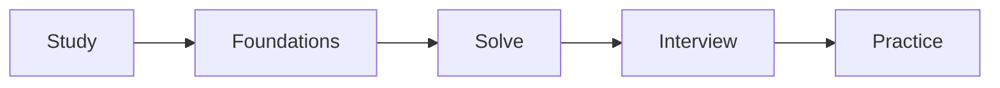

# Galhoom Path

**Learn and progress.**

One ordered backend craft pipeline. You do the work.

| Track | Focus |
|---|---|
| Study | Fundamentals & OOP |
| Foundations | Backend engineering |
| Solve | DSA & problem-solving |
| Interview | Technical interview prep |
| Practice | Learning builds (e.g. energy-conversion) |

---

**Shipped tools, CLIs, and products** live in **[galhoom-labs](https://github.com/galhoom-labs)** — not on this path.
