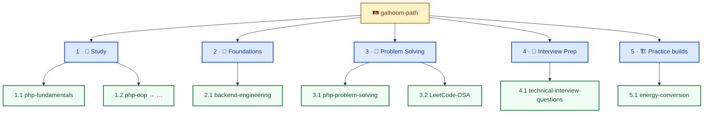

# Galhoom Path

**Learn and progress.**

This organization is for **studying and leveling up** — not for shipped products.

If you open **galhoom-path**, you are here to:
- Study fundamentals and craft
- Build foundations
- Practice problem-solving & DSA
- Prepare for interviews
- Do **practice** builds to learn (not to ship)

> One ordered path: **Study → Foundations → Solve → Interview → Practice**  
> You do the work. The goal is *your growth*.

| This org IS | This org is NOT |
|---|---|
| A learning roadmap | A product store |
| Study materials & curricula | Web / mobile / desktop products |
| Foundations, DSA, interview prep | Chrome extensions, games, CLIs for users |
| Practice projects to learn from | Things other people install and rely on |

**Real products** (apps, tools, extensions, games — anything people can use) live in **[galhoom-labs](https://github.com/galhoom-labs)**.

**[Open galhoom-labs →](https://github.com/galhoom-labs)** · Real products you can use

**Promise in one line:** Path = learn & grow. Labs = real products.
